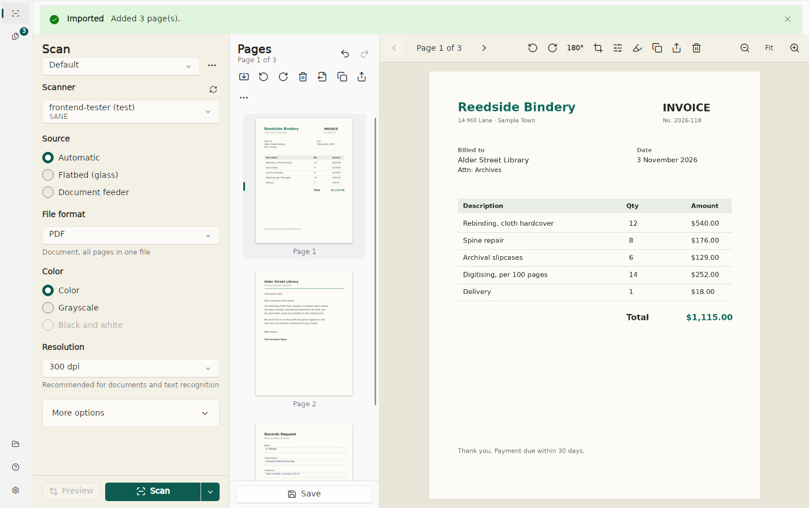

# Deckle

A simple, free and open-source document scanner for Windows, macOS and Linux.

**[Website](https://deckle.cjservin.com)** · **[Download the latest build](https://github.com/noddle-Cake/deckle/releases/latest)** · **[Support on Ko-fi](https://ko-fi.com/cjservin)**



Deckle combines two projects:

- **[Scanner](https://github.com/simon-knuth/scanner)** by Simon Knuth: the clean Fluent interface and the
  simple workflow (pick options, press Scan, the file is saved), plus automatic rotation, file naming patterns,
  scan merge, and crop and draw editing.
- **[NAPS2](https://github.com/cyanfish/naps2)**: the scanning engine and power features. Deckle uses the
  official `NAPS2.Sdk` packages for WIA, TWAIN, SANE and driverless network (eSCL/AirScan) scanners, PDF/OCR,
  profiles, batch scanning, deskew, blank-page removal and page reordering.

## Features

**Scanning**
- WIA and TWAIN (Windows), SANE (Linux, macOS) and driverless network scanners (eSCL/AirScan, all platforms)
- Flatbed, feeder and duplex; color, grayscale and black & white; device-specific resolutions
- Page sizes (A3–A5, B4/B5, Letter, Legal, custom), brightness and contrast
- Preview the glass and choose the area to scan
- Straighten crooked pages, skip blank pages
- **Automatic rotation** of upside-down and sideways pages, using Tesseract orientation detection or OCR comparison
- Profiles: save complete sets of scan options; the last-used options are always remembered
- **Scan merge**: insert a second pass between existing pages (two-sided documents without duplex)
- **Batch scan**: several scans in a row, waiting or asking in between, saved to one file or one file per scan
- Optional reverse page order, for feeders that deliver the last page first
- **Scan from outside the app**: right-click Deckle in the taskbar (Windows), dock or app list (Linux) or Dock
  (macOS) and choose Scan, or set a Ctrl+Alt+key shortcut in Settings (Windows and GNOME: works even when Deckle
  is closed; macOS: Control+Option+key while it runs). Everything runs `Deckle --scan`, which hands the scan to
  the open window if there is one

**Saving**
- **PDF, JPG, PNG, TIF, BMP**. PDF and TIF hold all pages in one file; the image formats write one file per page
- Saves automatically to your folder, or asks every time
- New scans can keep adding to the current PDF/TIFF, or start a new document each time
- **Custom file names** built from blocks: date and time parts, running number, scanner, resolution, color mode,
  source, brightness, contrast, file type, plus your own text
- Searchable PDFs (OCR in 100+ languages, downloadable in-app), PDF/A, metadata and password protection
- JPG quality and TIFF compression (CCITT G4 for black & white)
- **Copy a page to the clipboard** (Ctrl+C, ⌘C on macOS) or **share** pages (Ctrl+E) without saving first: the Windows share
  sheet, the macOS share menu (AirDrop, Mail, Messages…), or a new email via `xdg-email` (Linux). One page is shared as JPG, several as one PDF.
  On Linux, copying images needs `wl-clipboard` (Wayland) or `xclip` (X11)

**Looks like it belongs**
- Follows each platform's design guidelines: Microsoft's Fluent design on Windows (Mica, standard shortcuts),
  Apple's on macOS (menu bar, ⌘ shortcuts, toolbar, sidebar, Liquid Glass on macOS 26), GNOME's on Linux
  (header bar, primary menu, Preferences window)
- Settings ▸ Look lets any of the three run on any system (Automatic matches the OS); shortcuts keep following
  your keyboard (⌘ on a Mac, Ctrl elsewhere)

**Editing**
- Thumbnail page list: multi-select, drag to reorder, drop files to import, undo/redo
- Rotate, duplicate, delete, move, reverse, interleave/deinterleave
- Editor with zoom, crop (aspect presets including DIN A, ANSI, Legal and Kai sizes, plus "crop similar pages"),
  brightness/contrast/saturation/hue/sharpen, grayscale, black & white, straighten, pen and highlighter
- Import images (including multi-page TIFF) and PDFs
- Pages survive closing the app or a crash

## Install

Download the build for your platform and run `Deckle` (`Deckle.exe` on Windows). It is self-contained, so no .NET
install is needed.

| Windows | macOS | Linux |
|---|---|---|
| [x64](https://github.com/noddle-Cake/deckle/releases/latest/download/deckle-win-x64.zip) | [Apple Silicon](https://github.com/noddle-Cake/deckle/releases/latest/download/deckle-osx-arm64.zip) · [Intel](https://github.com/noddle-Cake/deckle/releases/latest/download/deckle-osx-x64.zip) | [x64](https://github.com/noddle-Cake/deckle/releases/latest/download/deckle-linux-x64.tar.gz) · [ARM64](https://github.com/noddle-Cake/deckle/releases/latest/download/deckle-linux-arm64.tar.gz) |

| Platform | Notes |
|---|---|
| Windows 10/11 | WIA works out of the box; install the scanner maker's driver for TWAIN. |
| Linux | Install SANE (`sudo dnf install sane-backends` / `sudo apt install sane-utils`) plus your scanner's backend (`hplip`, `sane-airscan`, `brscan`, …). Check that `scanimage -L` lists it. |
| macOS | Unzip and move `Deckle.app` to Applications. Network scanners work without drivers (allow local network access when asked); USB scanners use the bundled SANE. The download is not notarized by Apple: the first time, allow it in System Settings ▸ Privacy & Security. Shortcuts use ⌘ and every command is in the menu bar. |

Text recognition (auto-rotate, searchable PDFs) uses a system Tesseract if one is installed, otherwise the copy
bundled with Deckle. English and the orientation data are included; other languages download from Settings.

## Build

Requires the .NET 10 SDK.

```bash
dotnet build
scripts/test.sh                       # unit + headless UI tests; enables SANE's virtual test scanner
DECKLE_TEST_OSD_DIR=/path/with/osd.traineddata scripts/test.sh   # also covers orientation detection
DECKLE_SCREENSHOTS=/tmp/shots scripts/test.sh                    # keep UI screenshots
DECKLE_ROTATE_EVAL=1 scripts/test.sh      # also measure auto-rotate accuracy on 28 realistic pages (slow)
DECKLE_TEST_GSETTINGS=1 scripts/test.sh   # also the GNOME shortcut (uses a temporary keyfile backend, not dconf)
dotnet run --project src/Deckle.App
git tag v0.1.0 && git push origin v0.1.0   # GitHub Actions builds, signs and publishes the release
scripts/publish.sh                    # self-contained builds for linux-x64/arm64, win-x64, osx-x64/arm64
scripts/make-icon-font.py             # rebuild the Lucide icon font after editing Assets/Fonts/lucide-icons.txt
dotnet run --project src/Deckle.App -- --look=gnome   # try another look (windows, macos, gnome) without changing Settings
```

Layout: `src/Deckle.Core` (scanning, export, import, page model, no UI), `src/Deckle.App` (Avalonia +
FluentAvalonia UI), `tests/`, `site/` (the website). See `tasks.md` for the design decisions and `docs/SECURITY-NOTES.md` for the
ImageSharp pin.

## Known limitations

- macOS uses SANE and eSCL; Apple's native ImageCaptureCore driver needs a `net*-macos` build (not done yet).
- Password-protected PDFs can't be imported.
- No printing. Use "Open in another app" from the page menu.

## License

Mozilla Public License 2.0. Deckle's code is new; it re-implements the ideas of Scanner (MPL-2.0) and uses
NAPS2.Sdk (LGPL-2.1) as a library. Other components: Tesseract (Apache-2.0), Avalonia and FluentAvalonia (MIT),
Lucide icons (ISC; `src/Deckle.App/Assets/Fonts/LICENSE-lucide.txt`), ImageSharp (Six Labors Split License),
LibTiff.NET (BSD), PDFium (BSD). macOS builds also include SANE (GPL-2.0). Every build carries the full list and
license texts in its `licenses` folder; see [`licenses/THIRD-PARTY-NOTICES.md`](licenses/THIRD-PARTY-NOTICES.md).

Deckle was first called Scanwise; it moves settings and pages from that name on first start.

**Note:** `github.com/naps2-software/naps2-scanner` is an impostor repository, not NAPS2. Get NAPS2 only from
https://www.naps2.com or https://github.com/cyanfish/naps2.
